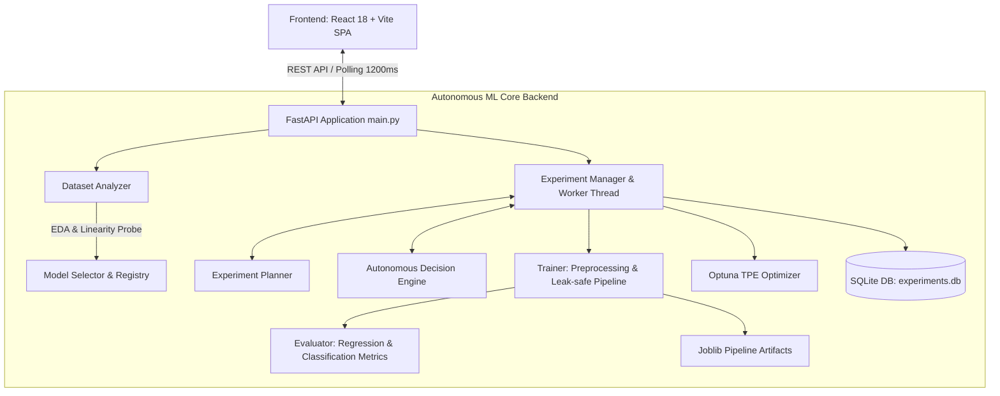

# ModelFinder – Examiner Presentation & Live Demo Guide
**Autonomous Machine Learning Experimentation & Decision System**  
*Final Pre-Presentation Master Document*

---

## 1. Quick Launch Instructions (Start Here)

Before the examiner arrives, ensure both backend and frontend servers are running:

### Terminal 1 – Backend (FastAPI + SQLite + ML Engine)
```powershell
cd D:\AI_PRAGATI_ANNANT\backend
.\.venv\Scripts\python.exe -m uvicorn main:app --host 127.0.0.1 --port 8000 --reload
```
*Verification:* Navigate to `http://127.0.0.1:8000/api/health` → `{"status": "healthy"}`.

### Terminal 2 – Frontend (React + Vite SPA)
```powershell
cd D:\AI_PRAGATI_ANNANT\frontend
npm run dev
```
*Verification:* Open `http://localhost:5173/` in Google Chrome / Edge.

---

## 2. System Architecture Overview

ModelFinder is built on a modular, asynchronous, leak-safe architecture separating exploratory data analysis, autonomous decision-making, hyperparameter optimization, and model lifecycle management.



### Core Backend Components
1. **Dataset Analyzer (`dataset_analyzer.py`)**: Automatic schema inference, distribution profiling, cardinality classification, correlation matrices, outlier detection, and empirical **Linearity Probe** (Linear Regression vs Decision Tree CV comparison).
2. **Model Selector (`model_selector.py`)**: Rule-based heuristic ranking based on dataset geometry ($N$ rows, $P$ features), linearity verdict, sparsity, and imbalance.
3. **Experiment Planner (`experiment_planner.py`)**: Resource budget calculation (RAM/CPU ceilings) and adaptive candidate scheduling.
4. **Trainer (`trainer.py`)**: Leak-free scikit-learn `Pipeline` (imputation, standard/min-max scaling, one-hot encoding fitted *only* on train fold), 3-way train/val/test splits, and memory-tracked fit execution.
5. **Evaluator (`evaluator.py`)**: Multi-metric evaluation (MAE, MSE, RMSE, $R^2$, MAPE for regression; Accuracy, Weighted/Macro F1, Balanced Accuracy, ROC-AUC, Log-Loss, Confusion Matrix for classification).
6. **Optimizer (`optimizer.py`)**: Bayesian optimization using Optuna's Tree-structured Parzen Estimator (TPE) over tailored parameter search spaces.
7. **Autonomous Decision Engine (`decision_engine.py`)**: State-machine tracking performance progression, plateau detection, early stopping, and strategy switching from *Exploration* to *Exploitation*.

---

## 3. High-Impact 5-Minute Presentation Script

### Minute 0:00 – 1:00 | The Pitch & Problem Statement
- **What to say:**
  > *"Good morning / afternoon. Traditional AutoML tools either brute-force grid searches or act as black boxes with zero insight into why certain algorithms were tested or discarded. **ModelFinder** is an **Autonomous ML Experimentation System** that acts like a seasoned data scientist. It inspects data geometry, performs linearity probing, dynamically budgets computational resources, iteratively explores model families, detects plateaus, and tunes champions using Bayesian optimization—explaining every single autonomous decision in plain English."*
- **Action:** Open `http://localhost:5173/` on the **Overview** page. Point out the aggregate metrics: total datasets analyzed, autonomous sessions, models evaluated, and active resource status.

### Minute 1:00 – 2:00 | Intelligent Data Profiling (DataStudio)
- **Action:** Click **DataStudio** in the top navigation bar. Select or load the **Customer Purchase** dataset (or **Linear / Nonlinear Housing** dataset).
- **What to say:**
  > *"Notice that ModelFinder does not require manual column configuration. It automatically detects the problem type (e.g. Binary Classification or Regression), flags class imbalance ratios, computes feature correlations, and flags outliers. For regression, it runs an empirical 3-fold CV Linearity Probe on a subsample to decide whether linear or tree-based models should take precedence."*
- **Highlight:** Show the **Linearity / Separability Verdict** chip and the target variable summary.

### Minute 2:00 – 3:30 | The Arena (Live Autonomous Brain in Action)
- **Action:** Switch to **Arena**. Select an existing session or launch a live quick experiment (e.g. Budget: 4 experiments, Balanced priority).
- **What to point out:**
  1. **Dynamic Execution Log:** Show real-time terminal output as scikit-learn pipelines train with zero data leakage.
  2. **The Decision Stream ("The Brain"):** Point out each decision card:
     - *Exploration Phase:* "Testing diverse families (Logistic Regression, KNN, Random Forest)..."
     - *Plateau / Superiority Decision:* "Model B outperformed Model A by +0.05 F1; switching from exploration to exploitation."
     - *Optimization Trigger:* "Bayesian TPE hyperparameter tuning initiated for the top-performing candidate."
     - *Early Stopping Guard:* "Experimentation terminated early: convergence reached / plateau detected."

### Minute 3:30 – 4:15 | Model Comparison & Trade-Off Analysis
- **Action:** Click **Comparison** in the top navigation.
- **What to say:**
  > *"In real-world engineering, the highest raw metric score isn't always the best production choice. ModelFinder features a multi-objective Trade-Off Analyzer with three priority modes: **Performance**, **Speed**, and **Balanced**."*
- **Highlight:**
  - Show the **Champion Recommendation Card** explaining *why* the winning model was chosen (e.g., within 2.5% tolerance of peak accuracy but 3x faster to train and infer).
  - Show the interactive **Scatter Plot (Score vs Training Time)** and the **Progression Curve**.
  - Click **Download Model (.joblib)** and **Export Leaderboard (CSV)** to demonstrate full artifact portability.

### Minute 4:15 – 5:00 | Live Interactive Playground & Real-Time Inference
- **Action:** Click **Playground** in the top navigation.
- **What to say:**
  > *"Once a model is trained and validated on an untouched held-out test split, it is immediately served for interactive inference."*
- **Highlight:**
  - Notice the feature input form is pre-populated with realistic values from the dataset.
  - Tweak a number (e.g., age, income, study hours) and click **Run Prediction**.
  - Point out the instantaneous response: predicted class / regression score, class probabilities (`[0.85, 0.15]`), and inference latency in milliseconds.
  - Show the auto-generated **Python Code Snippet** for production deployment.

---

## 4. Key Autonomous Highlights (Where to Direct the Examiner's Eyes)

| Feature | Where It Is Visible | What Makes It Scientifically Impressive |
| :--- | :--- | :--- |
| **Linearity Probing** | DataStudio & Overview | Evaluates CV ratio ($R^2_{\text{Linear}} / R^2_{\text{Tree}}$) before spending compute on deep models. |
| **Leak-Safe Preprocessing** | Backend Trainer & Logs | `ColumnTransformer` (imputation, scaling, one-hot encoding) is fit strictly on training splits, eliminating data leakage. |
| **Autonomous Decision Engine** | Arena → Decision Stream | Generates human-readable rationales (`headline`, `reasoning`, and numeric metric deltas) after every run. |
| **Bayesian Hyperparameter Optimization** | Arena & Leaderboard | Uses Optuna TPE over tailored search distributions rather than brute-force grid search. |
| **Multi-Objective Trade-Off Selection** | Comparison View | Ranks models using a composite utility function balancing score vs latency vs memory footprint. |
| **Untouched Test Set Evaluation** | Comparison & Metrics | Validation splits guide model selection; winning models are refitted and reported on a virgin test set. |

---

## 5. Anticipated Tough Examiner Questions & Bulletproof Answers

#### Q1: "How does your system prevent data leakage during preprocessing and cross-validation?"
> **Answer:** *"All preprocessing—including median imputation, standard scaling, and categorical encoding—is encapsulated inside a scikit-learn `Pipeline`. The transformations are fitted exclusively on the training folds (`X_train`) and only applied (`transform`) to validation and test folds. During cross-validation, pipelines are freshly cloned to ensure no parameter statistics leak between folds."*

#### Q2: "What is your autonomous decision engine based on? Is it a black-box LLM or deterministic logic?"
> **Answer:** *"It is a robust, deterministic autonomous state machine combining empirical heuristic rules with Bayesian optimization. It tracks relative performance improvement, variance bounds across folds, diversity of explored model families, and elapsed compute budgets. This guarantees 100% reproducibility, zero API hallucination risk, and sub-millisecond decision latency."*

#### Q3: "How do you avoid overfitting when selecting the best model?"
> **Answer:** *"We employ a rigorous three-way split: 60% Train, 20% Validation, and 20% Test (stratified for classification). Model exploration, iteration, and hyperparameter tuning are guided strictly by validation performance. Only after the final champion model is selected is it refitted on Train + Validation and evaluated once on the untouched held-out Test set to report true generalization ability."*

#### Q4: "Why did you implement a Linearity Probe instead of testing all models?"
> **Answer:** *"Testing ensemble trees or neural networks on linear datasets wastes compute and creates unnecessarily complex models with high inference latency. If our lightweight 3-fold CV probe reveals a linear relationship ($R^2 \ge 0.85$ and ratio $\ge 0.95$), the planner prioritizes regularized linear models (Ridge/Lasso/ElasticNet), achieving optimal performance in a fraction of the time."*

#### Q5: "How does the Trade-Off Ranking balance accuracy versus speed?"
> **Answer:** *"In balanced mode, ModelFinder computes a composite selection score: $S = 0.70 \times \text{Normalized Score} + 0.30 \times (1 - \text{Normalized Duration})$. In speed mode, it filters for models within a 2.5% tolerance band of the champion score and selects the model with the minimum training and inference latency."*

---

## 6. Examiner Demo Backup & Contingency Plan

If any unexpected interruption occurs during the live demonstration:

1. **Pre-Loaded Sessions Available:**
   - The SQLite database already contains completed sessions with full comparison leaderboards, decision streams, and trained `.joblib` model artifacts.
   - If you do not wish to wait for a 4-experiment run, simply click **History** or **Comparison** and select an existing session (`Student Performance` or `Customer Purchase`) to instantly show complete leaderboards and charts.

2. **Pre-Packaged Sample Datasets:**
   - In DataStudio, you don't need to hunt for CSV files on your disk. Simply click any of the built-in sample loaders:
     - `Sample Linear Regression`
     - `Sample Nonlinear Regression`
     - `Sample Classification`

3. **Restarting If Necessary:**
   - If a port is occupied: Backend runs on `8000`, Frontend runs on `5173`.
   - Backend health check: `http://127.0.0.1:8000/api/health`
   - All models and databases persist in `D:\AI_PRAGATI_ANNANT\backend\storage\`.
